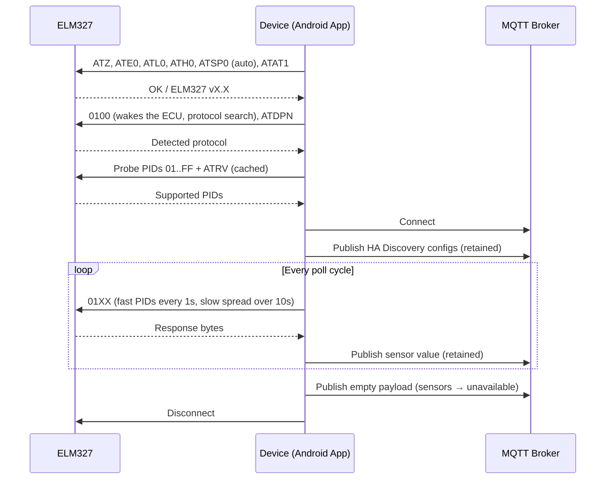

# OBD Scanner MQTT

Android app that reads OBD2 data from a vehicle via an ELM327 Bluetooth adapter and publishes sensor readings live to Home Assistant, over an HTTPS webhook (default) or MQTT Discovery. The UI is in French.

> 🇫🇷 **Guide Peugeot 407 + Vgate iCar Pro** : [docs/peugeot-407.md](docs/peugeot-407.md)

## Features

- Connects to ELM327 adapters via **Classic Bluetooth (SPP)** or **BLE** (Vgate iCar Pro BLE, FFF0 and FFE0 clones)
- Automatic OBD protocol detection (CAN, KWP2000, ISO 9141) — or force one in Settings
- Automatically scans all supported OBD2 PIDs (Mode 01), plus battery voltage read by the adapter (`AT RV`)
- Polls every discovered PID by default: fast ones every second, the others spread over 10 s
- Polls 39 mapped PIDs including RPM, speed, temperatures, fuel level, torque, and more
- Publishes to **Home Assistant** via MQTT with auto-discovery — sensors appear automatically, no manual configuration needed
- Or, for access over the internet, via an **HTTPS webhook** (no broker exposed to the WAN) — see [Webhook mode](#webhook-mode-https)
- Runs as a persistent **ForegroundService** with exponential backoff reconnection (5s → 10s → 30s → 60s)
- Marks sensors `unavailable` in HA when the car disconnects

## Requirements

- Android 13+ (minSdk 33)
- ELM327 OBD2 Bluetooth adapter (Classic or BLE)
- Vehicle with EOBD/OBD2 (petrol 2001+, diesel 2004+ in the EU) — confirmed on Jaecoo 7 / OMODA (CAN); target: Peugeot 407 (CAN or KWP2000 depending on engine)
- MQTT broker (e.g. Mosquitto running alongside Home Assistant) **or** Home Assistant reachable over HTTPS (webhook mode)

## Setup

1. Pair your ELM327 adapter in Android **Settings → Bluetooth**
2. Open the app → **Settings**
3. Select the paired ELM327 device
4. Enter your MQTT broker IP, port, and credentials (if any)
5. Optionally set device name/model/manufacturer (used in HA entity names)
6. Tap **Start** on the main screen

The app will connect to the adapter, initialize ELM327, scan supported PIDs, and start publishing to MQTT. Home Assistant will auto-create a device with all supported sensors.

## Webhook mode (HTTPS)

When the phone reaches Home Assistant over the internet (mobile data in the car), exposing an MQTT broker is risky. Webhook mode instead POSTs readings to a [Home Assistant webhook trigger](https://www.home-assistant.io/docs/automation/trigger/#webhook-trigger):

```
POST https://<your-ha>/api/webhook/<webhook-id>
{"available":true,"ts":1729500000000,"device":"Jaecoo 7","pids":{"0C":850,"0D":42}}
```

**Security**

- HTTPS only — `http://` URLs are rejected; the certificate must be valid (Let's Encrypt, Nabu Casa, reverse proxy…)
- The webhook ID is a 256-bit random secret generated in the app; it is the only credential, so keep it private (it's masked in the UI and copied to the clipboard as sensitive)
- POST only; HTTP redirects are never followed, so the payload can't be bounced to another host
- Rotate it any time with **New ID**, then re-copy the YAML into HA

**Setup**

1. Settings → **Home Assistant Connection** → **Webhook HTTPS**
2. Enter your external HA URL (e.g. `https://ha.example.com` or `https://xxxx.ui.nabu.casa`) and tap **Test Connection**
3. Start the service once so PIDs are discovered, choose the PIDs to poll, then tap **Copy Home Assistant YAML**
4. Paste it into `configuration.yaml` (or a file under `/config/packages/`) and reload **Template entities** in Developer tools → YAML

The YAML defines trigger-based template sensors (one per polled PID, with `unique_id`, unit, `device_class` and `state_class`). Each request carries the full snapshot of current values, sent at most every *Send interval* seconds (default 5), so a lost request in a tunnel is simply replaced by the next one; a failing network never interrupts the Bluetooth session. On disconnect, an `{"available":false}` payload marks the sensors `unavailable`.

> HA always answers `200 OK` on `/api/webhook/…`, even for an unknown ID, so **Test Connection** proves reachability and TLS, not that the YAML is loaded.

## MQTT Topics

| Topic | Description |
|---|---|
| `homeassistant/sensor/obd2_<mac>/<PID>/config` | HA MQTT Discovery config (retained) |
| `obd2/<mac>/<PID>/state` | Sensor value, updated every poll cycle (retained) |

When the app stops or disconnects, all state topics receive an empty payload, marking sensors as `unavailable` in HA.

## Mapped PIDs

| PID | Sensor (FR) | Unit |
|---|---|---|
| 0x04 | Charge moteur | % |
| 0x05 | Température liquide de refroidissement | °C |
| 0x0B | Pression collecteur admission | kPa |
| 0x0C | Régime moteur | rpm |
| 0x0D | Vitesse | km/h |
| 0x0F | Température air admission | °C |
| 0x10 | Débit air | g/s |
| 0x11 | Position papillon | % |
| 0x2F | Niveau carburant | % |
| 0x33 | Pression atmosphérique | kPa |
| 0x42 | Tension calculateur | V |
| 0x46 | Température extérieure | °C |
| 0x5C | Température huile | °C |
| 0x5E | Consommation instantanée | L/h |
| 0xA6 | Kilométrage | km |
| 0x100 (AT RV) | Tension batterie (mesurée par l'adaptateur) | V |
| ... | [60 PIDs total](app/src/main/java/com/frodrigues/obdmqtt/obd/PidRegistry.kt) | |

Sensor names are in French (the app UI is French). Which PIDs actually respond depends on the car's ECU.

## Architecture



## Tech Stack

- Kotlin + Jetpack Compose
- HiveMQ MQTT Client 1.3.3
- AndroidX DataStore (settings persistence)
- AndroidX Lifecycle / LifecycleService
- Navigation Compose

## Building

```bash
./gradlew assembleDebug    # debug APK
./gradlew assembleRelease  # release APK (requires signing config)
```

## License

MIT
